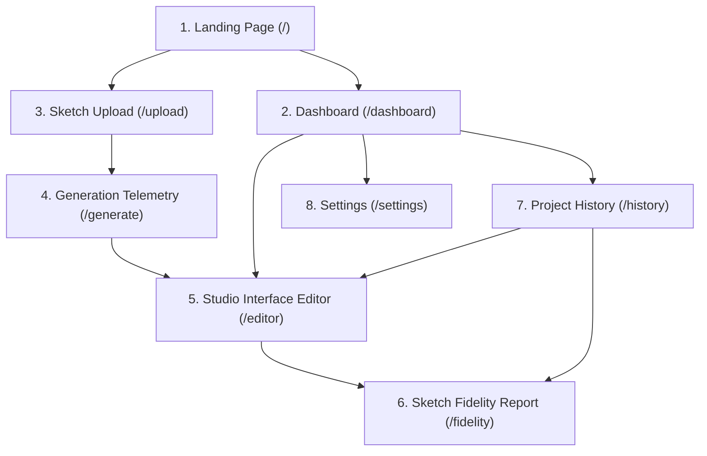

# S2S ux (Sketch2Screen AI) — Visual Design System Specification

**Document Version:** 1.0.0  
**Target:** Web Application & UI Component Studio  
**Foundation:** Tailwind CSS, Framer Motion, Lucide React, Strict TypeScript  

---

## 1. Design Philosophy & Direction

The **Sketch2Screen AI (S2S ux)** design system delivers a high-precision, technical developer studio experience. Designed specifically to avoid generic, uninspired AI templates, the interface feels like an advanced creative workbench: purposeful, calm, dark, and luminous.

### Core Visual Tenets:
- **Dark Navy & Charcoal Foundation:** Backgrounds transition between deep obsidian (`#060a12`), dark navy (`#0b1120`), and charcoal panels (`#111722`) to minimize eye strain during long design and coding sessions.
- **Electric Blue & Vivid Violet Accents:** High-chroma electric blue (`#3b82f6` / `#60a5fa`) draws focus to primary interactive elements, while violet (`#8b5cf6`) highlights AI interpretations and telemetry.
- **Subtle Glassmorphism & Thin Borders:** Borders use fine rgba opacities (`border-white/10` or `border-slate-800`), layered with backdrop blur (`blur-md` / `blur-xl`) and hairline inner highlights.
- **Restrained Motion:** Animations strictly communicate state changes and layout feedback (e.g. spring transitions for modals, toast slide-ups, scanning laser on sketch processing). Gimmicky loops and heavy parallax are avoided.
- **Honest Telemetry & Zero Deception:** Real OpenCV layout scores and contour overlays are displayed alongside transparent disclaimers. Empty states and demo data are clearly labeled.

---

## 2. Color Palette & Token Hierarchy

### 2.1 Surface & Neutral Foundations
| Token | Hex | Role / Application |
|---|---|---|
| `navy-950` | `#060a12` | App canvas background, root viewport container |
| `navy-900` | `#0b1120` | Top header, navigation bar, secondary panels |
| `charcoal-900` | `#111722` | Cards, modal dialogues, sidebar drawer backgrounds |
| `charcoal-850` | `#161e2c` | Interactive card hover states |
| `charcoal-800` | `#1d2638` | Deep card insets, code blocks, canvas borders |

### 2.2 Brand & Interactive Accents
| Token | Hex | Role / Application |
|---|---|---|
| `electric-600` | `#2563eb` | Primary action buttons, active navigation indicator |
| `electric-500` | `#3b82f6` | Focus-visible rings, border highlights, key metrics |
| `electric-400` | `#60a5fa` | Secondary highlights, text gradient accents, link hovers |
| `violet-600` | `#7c3aed` | AI pipeline status badges, gradient CTA buttons |
| `violet-500` | `#8b5cf6` | Multimodal annotations, AST tree highlighting |
| `violet-400` | `#a78bfa` | AI recommendation text accents |

### 2.3 Semantic Feedback Tokens
| Semantic Role | Border Token | Background Fill | Text Token |
|---|---|---|---|
| **Success / High Fidelity** | `border-emerald-500/30` | `bg-emerald-500/10` | `text-emerald-400` |
| **Warning / Layout Shift** | `border-amber-500/30` | `bg-amber-500/10` | `text-amber-400` |
| **Danger / Missing / Error** | `border-red-500/30` | `bg-red-500/10` | `text-red-400` |
| **Info / Annotation** | `border-blue-500/30` | `bg-blue-500/10` | `text-blue-400` |

---

## 3. Typography System

The application pairs **Plus Jakarta Sans** for crisp, geometric UI headlines and labels with **JetBrains Mono** for code, coordinates, latency metrics, and AST data.

```
Font Families:
- Primary Sans: 'Plus Jakarta Sans', system-ui, -apple-system, sans-serif
- Monospace:    'JetBrains Mono', 'Fira Code', ui-monospace, monospace
```

### Scale & Hierarchy
- **Display 1 (`text-4xl` to `text-7xl`):** Landing page hero headlines. Line-height 1.1, tracking tight.
- **Heading 1 (`text-2xl` to `text-3xl`):** Dashboard and workspace page headers. Font weight 700.
- **Heading 2 (`text-xl` to `text-2xl`):** Section titles, canvas viewport frame titles.
- **Heading 3 (`text-base` to `text-lg`):** Card headers, modal titles. Font weight 600.
- **Body (`text-sm` / 14px):** Primary interface text, form inputs, button labels. Line-height 1.5.
- **Caption (`text-xs` / 12px):** Secondary descriptions, table text, metadata readouts.
- **Mono Small (`text-[10px]` to `text-[11px]`):** Normalized coordinates $[0, 1000]$, bounding box dimensions, pipeline latency in milliseconds.

---

## 4. Reusable Component Catalog

All components reside in `src/components/ui/` and adhere to strict TypeScript interfaces:

### 1. Button (`Button.tsx`)
- **Variants:** `primary`, `secondary`, `outline`, `ghost`, `danger`, `gradient`.
- **Sizes:** `xs` (24px), `sm` (32px), `md` (40px), `lg` (48px).
- **Features:** Asynchronous loading spinner, left and right icon slots, accessible `focus-visible:ring-2` outline.

### 2. Input (`Input.tsx`)
- **Features:** Floating label support, helper text, error messages, prefix/suffix icon slots, dark inset styling with zero browser outline bleeding.

### 3. Card (`Card.tsx`)
- **Compound Structure:** `<Card>`, `<CardHeader>`, `<CardTitle>`, `<CardDescription>`, `<CardContent>`, `<CardFooter>`.
- **Variants:** `default` (charcoal panel), `glass` (blurred navy), `interactive` (hover border glow and elevation), `outline` (dashed wireframe dropzone).

### 4. Modal (`Modal.tsx`)
- **Features:** Framer Motion animated backdrop blur, scale entrance spring, automatic `Escape` key capture, body scroll lock, accessible ARIA attributes (`role="dialog"`, `aria-modal="true"`).

### 5. Tooltip (`Tooltip.tsx`)
- **Features:** Hover and focus triggered, positionable (`top`, `bottom`, `left`, `right`), 150ms delay dampener, dark pill styling.

### 6. Dropdown (`Dropdown.tsx`)
- **Features:** Click outside detection, keyboard navigable, supports icons, divider groups, danger actions.

### 7. Toast Notifications (`Toast.tsx` / `ToastProvider`)
- **Features:** Global context hook (`useToast()`), types: `success`, `error`, `warning`, `info`. Auto-dismisses in 4000ms with slide-up entrance.

### 8. Loading Indicators (`LoadingIndicator.tsx`)
- **Components:**
  - `Spinner`: Dual-ring rotating glow loader.
  - `Skeleton`: Shimmering placeholder box with subtle pulse.
  - `SketchScanEffect`: Futuristic cyan laser scan overlay demonstrating computer vision image segmentation.

### 9. Navigation (`AppNavbar.tsx`)
- **Features:** Persistent sticky top navigation, active route pill highlights, studio launch button, engine readiness status.

### 10. Tabs (`Tabs.tsx`)
- **Variants:** `pill` (segmented button group) and `underline` (minimal tab bar with electric blue underline bar). Supports badge counters.

### 11. Badges (`Badge.tsx`)
- **Variants:** `primary`, `secondary`, `success`, `warning`, `danger`, `violet`, `neutral`. Supports animated status dot.

### 12. Empty States (`EmptyState.tsx`)
- **Features:** High-quality illustration placeholder, title, description, and primary + secondary action buttons.

### 13. Error States (`ErrorState.tsx`)
- **Features:** Clear error description, status error codes, monospace technical details box, and retry trigger.

---

## 5. Sandboxed Allowlisted Component Registry

To strictly adhere to security guidelines (preventing arbitrary code execution and cross-site scripting):

| Registry Element | Permitted Props | Safety Handling |
|---|---|---|
| `Button` | `label`, `variant`, `size`, `disabled` | Pure text label; no inline script handlers. |
| `Card` | `title`, `subtitle`, `shadow`, `border` | Children rendered recursively through registry. |
| `Input` | `label`, `placeholder`, `inputType`, `disabled` | Input types restricted to standard form values. |
| `Heading` | `text`, `level` (1-6), `align` | Mapped to intrinsic `<h1>`-`<h6>` tags. |
| `Text` | `content`, `variant` | Escaped string text only. |
| `Container` | `layout`, `gap`, `padding` | Pure flexbox / CSS grid wrapper. |
| `Navbar` | `title`, `links`, `hasUserAvatar` | Standard navigation bar presentation. |
| `Table` | `headers`, `rows` | Rendered as accessible HTML `<table>` elements. |
| `Badge` | `text`, `variant` | Rendered with status colors. |
| `Avatar` | `fallback`, `size`, `src` | Image URL sanitized; initial fallback. |
| `Checkbox` | `label`, `checked` | Accessible visual checkbox. |
| `ImagePlaceholder` | `caption`, `alt`, `aspectRatio` | Blueprint box with icon; no external script load. |
| `FallbackElement` | *Any unknown element* | Renders safe amber diagnostic box without crashing. |

---

## 6. Page Inventory & UX Architecture

The application implements all 8 required studio views:



---
*End of Design System Specification.*
