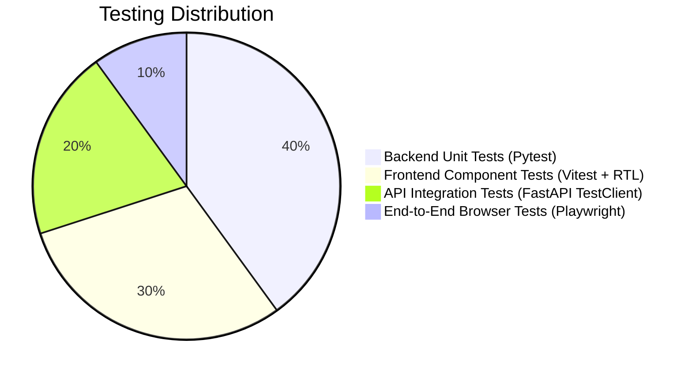

# S2S ux (Sketch2Screen AI) — Staged Development & Testing Plan

**Document Version:** 1.0.0  
**Status:** Approved Master Plan  
**Target Delivery:** Multi-stage incremental release  

---

## 1. Development Philosophy & Methodology

To ensure stability, security, and exceptional code quality, development is broken down into **9 sequential, test-driven stages**. Each stage contains:
- Concrete implementation deliverables.
- Strict acceptance criteria.
- Automated tests that must pass before advancing to the next stage.
- Zero placeholder code policy (no `# TODO` or `// TODO` for core features).

---

## 2. Staged Roadmap Overview

| Stage | Milestone | Primary Focus | Output Deliverables |
|---|---|---|---|
| **Phase 1** | Project Initialization & Tooling | Workspace setup, strict TypeScript, Python virtual environment, linting | Project scaffold, configs, dev scripts |
| **Phase 2** | Domain Core & AST Schema | Pydantic AST models, TS interfaces, mock test fixtures | Data schemas, serialization tests |
| **Phase 3** | Computer Vision & Preprocessing | OpenCV contour detection, noise suppression, bounding box normalization | CV Engine, unit tests with synthetic sketches |
| **Phase 4** | AI Provider Abstraction & VLM | Gemini integration, mock provider, structured prompt pipeline | VLM adapters, schema retry mechanism |
| **Phase 5** | Fidelity Checker Engine | Hungarian bipartite matcher, IoU calculator, Canny edge SSIM | Fidelity service, metric tests |
| **Phase 6** | Backend API & Endpoints | FastAPI routes (`/sketch`, `/fidelity`, `/export`, `/health`) | Full REST API, integration tests |
| **Phase 7** | Frontend Design System & Registry | Tailwind setup, allowlisted component registry, layout shell | UI components, design tokens |
| **Phase 8** | Studio Canvas & Component Editor | AST renderer, click-to-select, property inspector, live preview | Interactive visual editor, Zustand store |
| **Phase 9** | Code Export & End-to-End Testing | AST-to-React compiler, ZIP package generator, E2E tests | Export modal, ZIP download, Playwright suite |

---

## 3. Detailed Stage Breakdown

### Phase 1: Workspace Scaffolding & Environment Setup
- **Goal:** Set up a clean, robust monorepo structure with automated tooling for both frontend and backend.
- **Tasks:**
  1. Initialize Git repository with comprehensive `.gitignore`.
  2. Backend: Create `backend/` directory, set up `pyproject.toml`, virtual environment, dependencies (`fastapi`, `uvicorn`, `pydantic`, `pillow`, `opencv-python-headless`, `google-genai`, `pytest`).
  3. Frontend: Initialize Vite React TypeScript project in `frontend/`, configure Tailwind CSS, PostCSS, Lucide React, Framer Motion, Zustand.
  4. Create root orchestrator scripts / `Makefile` or `npm run` scripts for unified development.
- **Acceptance Criteria:**
  - `pytest` executes cleanly in `backend/`.
  - `npm run build` and `npm run test` execute cleanly in `frontend/`.
  - Zero linting errors on both stacks.

### Phase 2: Domain Models & AST Schema Specification
- **Goal:** Define the single source of truth: the S2S UI AST schema in both Python (Pydantic v2) and TypeScript.
- **Tasks:**
  1. Backend `app/domain/ast_models.py`: Implement `S2SNode`, `S2SNodeTree`, `ComponentType`, `BoundingBoxNormalized` with strict field validation and recursion depth limits.
  2. Frontend `src/types/ast.ts`: Mirror Pydantic schemas in strict TypeScript types.
  3. Create test fixtures (`fixtures/sample_ast_dashboard.json`, `fixtures/sample_ast_form.json`).
  4. Write serialization/deserialization unit tests verifying bi-directional consistency.
- **Acceptance Criteria:**
  - Pydantic models reject invalid node types, negative bounding boxes, and nesting exceeding 12 levels.
  - TypeScript types compile with `strict: true`.

### Phase 3: Computer Vision & Sketch Preprocessing Engine
- **Goal:** Implement the image processing pipeline to extract contours, clean paper/whiteboard noise, and detect candidate UI bounding boxes.
- **Tasks:**
  1. Implement `CVEngine` in `app/services/cv_engine.py`:
     - Image validation (magic bytes, dimensions, aspect ratio).
     - Grayscale conversion, adaptive thresholding (Otsu), bilateral filtering.
     - Morphological gradient operations to isolate sketch lines.
     - `cv2.findContours` and hierarchical bounding box normalization $[0, 1000]$.
  2. Implement visual debug contour renderer (generates annotated debug image showing detected blocks).
  3. Write unit tests with synthetic sketches verifying contour detection and coordinate normalization.
- **Acceptance Criteria:**
  - Extracts bounding boxes accurately from synthetic sketch fixtures.
  - Rejects corrupted or non-image files with clear HTTP 400 errors.

### Phase 4: AI Provider Abstraction & VLM Pipeline
- **Goal:** Build the provider-agnostic AI layer with Google Gemini and deterministic Mock providers.
- **Tasks:**
  1. Create `IVLMProvider` interface in `app/providers/base.py`.
  2. Implement `GeminiVLMProvider` in `app/providers/gemini_provider.py` using `google-genai` SDK:
     - Structured JSON schema enforcement using Gemini 2.5/1.5 Flash.
     - Custom system prompt encoding the allowlisted component vocabulary and annotation rules.
  3. Implement `MockVLMProvider` in `app/providers/mock_provider.py` for offline development and deterministic unit testing.
  4. Implement `VLMProviderFactory` to toggle providers via `VLM_PROVIDER` env var.
  5. Build schema validation and single-attempt JSON repair retry mechanism.
- **Acceptance Criteria:**
  - System never leaks `GEMINI_API_KEY` to client or error responses.
  - Mock provider returns 100% valid AST trees matching test sketches.
  - Failed AI generations return structured domain errors, never fabricated success.

### Phase 5: Sketch Fidelity Checker Engine
- **Goal:** Deliver the multi-tier quantitative fidelity evaluation system.
- **Tasks:**
  1. Implement `FidelityChecker` in `app/services/fidelity_checker.py`:
     - **Tier 1 (Layout IoU):** Hungarian algorithm for bipartite matching between OpenCV sketch contours and AST bounding boxes; calculates mean IoU.
     - **Tier 2 (Edge SSIM):** Renders AST bounding boxes into a binary wireframe mask; runs multi-scale SSIM against Canny-filtered sketch.
     - **Tier 3 (Semantic Alignment):** Evaluates handwritten label/annotation presence in AST component props via tokenized fuzzy matching.
     - Composite weighted aggregator with rating classification (`high`, `moderate`, `low`).
  2. Formulate explicit transparent disclaimer and diagnostic feedback per element.
  3. Unit test with aligned vs misaligned AST fixtures to prove score sensitivity.
- **Acceptance Criteria:**
  - Aligned AST fixture scores $>80\%$; intentionally displaced AST fixture scores $<50\%$.
  - Clear distinction between measured CV metrics and semantic estimates.

### Phase 6: Backend API & Endpoints
- **Goal:** Expose clean REST endpoints with validation, logging, and error handling.
- **Tasks:**
  1. Create FastAPI router in `app/api/v1/router.py`:
     - `POST /api/v1/sketch/analyze`
     - `POST /api/v1/sketch/generate`
     - `POST /api/v1/fidelity/evaluate`
     - `POST /api/v1/export/react`
     - `POST /api/v1/export/project-zip`
     - `GET /api/v1/providers/status`
     - `GET /api/v1/health`
  2. Add CORS middleware, request size limiter, and global exception handlers.
  3. Write Pytest integration tests covering full request-response lifecycles.
- **Acceptance Criteria:**
  - All endpoints return documented OpenAPI schema responses.
  - Endpoints handle missing files, malformed JSON, and oversized images gracefully.

### Phase 7: Frontend Design System & Allowlisted Component Registry
- **Goal:** Build the visual design foundation and the zero-eval safe component registry.
- **Tasks:**
  1. Configure Tailwind CSS with modern dark palette (`slate-950`, `indigo-500`, `violet-500`, `zinc-800`), glassmorphism utilities, and typography.
  2. Create atomic UI controls in `src/components/common/` (Button, Input, Modal, Badge, Tooltip).
  3. Implement allowlisted element registry in `src/registry/`:
     - `ButtonElement`, `CardElement`, `InputElement`, `HeadingElement`, `TextElement`, `ContainerElement`, `NavbarElement`, `TableElement`, `BadgeElement`, `AvatarElement`, `CheckboxElement`, `ImagePlaceholderElement`.
     - `FallbackElement` for unknown nodes.
  4. Build safe recursive `ASTLiveRenderer` component.
  5. Test registry elements with Vitest and React Testing Library.
- **Acceptance Criteria:**
  - Safe rendering: zero use of `eval`, `new Function`, or `dangerouslySetInnerHTML`.
  - Component registry renders all supported elements responsive to props.

### Phase 8: Interactive Studio Canvas & Component Editor
- **Goal:** Create the core user experience: sketch upload, live preview, and component-level visual editing.
- **Tasks:**
  1. Implement `useEditorStore` (Zustand): AST state, node selection, history stack (undo/redo).
  2. Build `SketchUploadDropzone` with drag-and-drop, sample sketches, and client preview.
  3. Build `AnnotationTool` allowing users to click and pin notes/hints onto the sketch image before generation.
  4. Build `PanZoomCanvas` with responsive viewport presets (Desktop 1280px, Tablet 768px, Mobile 375px).
  5. Implement `ComponentTree` (hierarchical outline in sidebar with drag-to-reorder).
  6. Implement `PropertyInspector` (contextual prop and style editor based on selected node).
  7. Implement `FidelityReportCard` and side-by-side comparison slider (Original Sketch vs Live UI).
- **Acceptance Criteria:**
  - User can click an element on canvas to inspect and edit its props.
  - Changes instantly update the live preview without re-rendering the whole page.
  - Undo (`Cmd+Z`) and Redo (`Cmd+Shift+Z`) work flawlessly.

### Phase 9: Secure Code Export Engine & End-to-End Validation
- **Goal:** Implement the React code compiler, project ZIP exporter, and complete testing suite.
- **Tasks:**
  1. Build AST-to-React/Tailwind compiler (`src/services/astCompiler.ts`):
     - Formats clean JSX with TypeScript interfaces.
     - Escapes all text and attribute strings to prevent injection.
  2. Build ZIP package generator: creates full Vite + React + Tailwind starter project bundle.
  3. Implement `CodeExportModal` with tabbed views:
     - Standalone TSX preview with syntax highlighting.
     - Project ZIP download.
     - One-click copy to clipboard with toast notification.
  4. Write Playwright E2E tests:
     - Flow 1: Upload sketch -> Generate UI -> Verify elements render in preview.
     - Flow 2: Select element -> Change label -> Verify live update -> Verify exported code reflects change.
     - Flow 3: View Fidelity Report -> Check scores & disclaimers.
     - Flow 4: Export code as TSX and verify output validity.
- **Acceptance Criteria:**
  - Exported code runs in a standard Vite+React project without build errors.
  - Playwright test suite passes completely.

---

## 4. Comprehensive Testing Strategy

### 4.1 Testing Pyramid

### 4.2 Test Automation Specifications

#### 1. Backend Unit & Integration Tests (Pytest)
- **Directory:** `backend/tests/`
- **Execution Command:** `pytest -v --cov=app tests/`
- **Coverage Target:** $\ge 85\%$ line coverage across domain, services, and API endpoints.
- **Key Test Suites:**
  - `test_ast_models.py`: Schema validation, nested depth restrictions, prop mutations.
  - `test_cv_engine.py`: Image pre-processing, noise removal, contour coordinates.
  - `test_fidelity_checker.py`: Math verification for Hungarian IoU, Canny SSIM, and semantic metrics.
  - `test_vlm_providers.py`: Mock provider determinism, Gemini schema prompt validation, error handling.
  - `test_sketch_api.py`: Upload, analyze, and generate endpoints with synthetic multipart payloads.

#### 2. Frontend Unit & Component Tests (Vitest + RTL)
- **Directory:** `frontend/src/__tests__/`
- **Execution Command:** `npm run test`
- **Key Test Suites:**
  - Registry element tests: verifies each element renders appropriate HTML and classes from props.
  - `ASTLiveRenderer.test.tsx`: checks recursion, leaf node rendering, and fallback on unknown node types.
  - `useEditorStore.test.ts`: tests state transitions (selectNode, updateProps, moveNode, undo, redo).
  - `astCompiler.test.ts`: verifies string escaping, JSX structure, and Tailwind class emission.

#### 3. End-to-End Browser Tests (Playwright)
- **Directory:** `frontend/e2e/`
- **Execution Command:** `npx playwright test`
- **Key Scenarios:**
  - Upload sketch fixture -> Trigger generation -> Verify canvas nodes populated.
  - Visual editing: Click button on preview -> Edit label in inspector -> Verify label changed in canvas and exported code.
  - Fidelity report modal opens and renders real scores with transparent disclaimer.
  - Export modal: Code copy button and ZIP download trigger without errors.

---

## 5. Technical Decisions & Architectural Rationale

1. **Why an AST instead of direct JSX output from the VLM?**
   - *Security:* Directly executing or rendering AI-generated JSX requires dynamic evaluation (`eval`, Babel standalone, or iframes), introducing massive XSS attack surfaces.
   - *Editability:* A JSON AST is trivially inspected, traversed, mutated (drag-and-drop, prop updates), and serialized to undo/redo stacks.
   - *Determinism:* We can validate the AST against strict Pydantic/Zod schemas before any rendering occurs.
2. **Why a 3-tier Fidelity Checker instead of a generic VLM "rating"?**
   - Asking a VLM "rate this design from 1 to 10" produces hallucinated, arbitrary numbers.
   - By calculating **IoU on OpenCV-detected contours**, **Canny edge SSIM**, and **semantic label recall**, we produce mathematically reproducible metrics that objectively reflect layout alignment and annotation coverage.
3. **Why Google Gemini as the primary VLM?**
   - Gemini 2.5 Flash / 1.5 Pro models provide exceptional multimodal spatial reasoning, native structured JSON schema mode, fast response times (critical for interactive UX), and large context windows.
   - Our provider abstraction ensures that switching or falling back to other models (OpenAI GPT-4o, Claude 3.5 Sonnet, or local Ollama) requires editing only a single adapter class.
4. **Why Zustand for Frontend State?**
   - Zero boilerplate compared to Redux, fine-grained selector re-renders for snappy canvas interactions, and seamless integration with persistent or temporal (undo/redo) middleware.

---
*End of Development & Testing Plan.*
